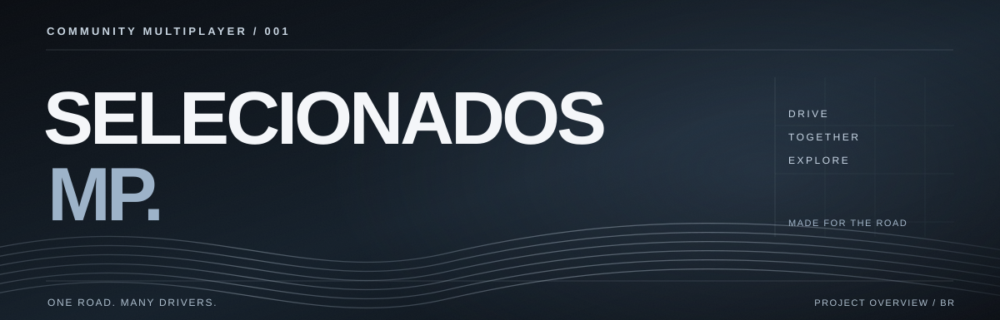

  

  <strong>Uma estrada. Vários motoristas. A mesma viagem.</strong>

  Experiência multiplayer comunitária de condução de caminhões.

---

01 / VISÃO GERAL

## O que é o SelecionadosMP?

O **SelecionadosMP** é um projeto independente de multiplayer voltado à **simulação de condução de caminhões**. A proposta é reunir motoristas virtuais em sessões compartilhadas, onde cada pessoa pode seguir sua rota, encontrar outros jogadores e participar de viagens em grupo.

A experiência é construída em torno de três ideias: **dirigir junto, conviver na estrada e valorizar a comunidade**.

O projeto está **em desenvolvimento**, com participação em etapas de testes de acesso controlado. Funcionalidades e disponibilidade podem variar entre versões.

 

02 / EXPERIÊNCIA DE JOGO

## Como funciona?

1. **Participação:** o jogador cria seu perfil e solicita entrada na comunidade. O acesso às sessões de teste depende de aprovação.
2. **Preparação:** após receber acesso, o jogador utiliza o aplicativo de inicialização para entrar na experiência multiplayer.
3. **Estrada compartilhada:** motoristas conectados à mesma sessão podem se encontrar durante as viagens e acompanhar a presença de outros veículos.
4. **Viagens em grupo:** os participantes podem combinar rotas e formar comboios, respeitando as regras de convivência.
5. **Comunidade:** a experiência incentiva direção responsável, colaboração e respeito entre jogadores.

> O acesso é limitado durante o desenvolvimento. A descrição representa a proposta de jogo; determinados recursos ainda passam por testes e ajustes.

 

03 / O QUE DEFINE A EXPERIÊNCIA

## Feito para viajar acompanhado.

| ESTRADAS COMPARTILHADAS | COMBOIOS | CONVIVÊNCIA |
| :--- | :--- | :--- |
| A sensação de dividir a rota com outros motoristas. | Viagens organizadas em grupo, do ponto de partida ao destino. | Uma comunidade com regras para manter as sessões agradáveis. |

**Em evolução:** representação de outros jogadores, comunicação durante viagens e elementos da interface de jogo. A prioridade é aprimorar estabilidade e consistência antes de ampliar o acesso.

 

04 / LINGUAGENS

## Como é desenvolvido?

O projeto combina linguagens com diferentes funções:

| Linguagem | Utilização geral |
| :--- | :--- |
| **C++** | Componentes nativos ligados à experiência no jogo. |
| **JavaScript** | Aplicações de apoio e funcionalidades da plataforma. |
| **HTML e CSS** | Construção e apresentação das interfaces. |

As tecnologias evoluem junto com o projeto. Esta apresentação descreve apenas as áreas gerais de desenvolvimento.

 

05 / ESTADO DO PROJETO

## Desenvolvimento contínuo.

O SelecionadosMP é um projeto experimental de comunidade, **não um lançamento aberto ao público**. A experiência é disponibilizada gradualmente para testes e melhorias.

Este repositório tem caráter **exclusivamente informativo**: apresenta o conceito, o modo de jogar e as linguagens utilizadas. Não disponibiliza código-fonte, instaladores ou configurações internas.

  SELECIONADOSMP / COMMUNITY MULTIPLAYER EXPERIENCE

